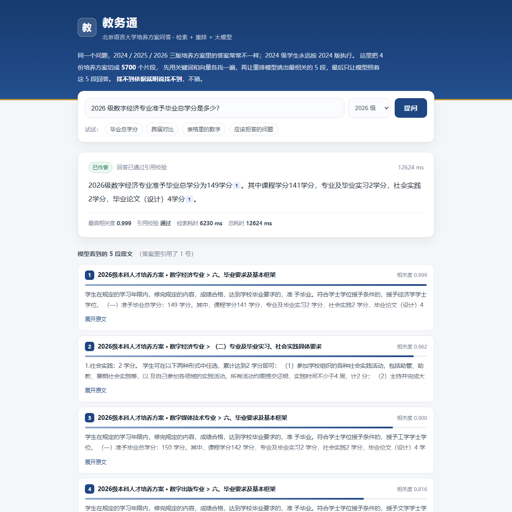

# 教务问答 RAG（blcu-qa）

面向北京语言大学本科培养方案的检索增强问答系统。语料是全校 2024 / 2025 / 2026 三个年级的培养方案
（合订本共 4 卷），重点解决**结构切块**、**跨届版本隔离**、**混合检索**与**引用溯源**四个工程问题。

## 演示


上面这段是脚本自动录的（`scripts/record_demo.py`，用 Edge 的 DevTools 协议逐帧抓屏再合成 GIF，
不是手动录屏）。流程：逐字输入问题 → 检索期间显示骨架屏 → 作答、每句带 `[n]` 角标 →
滚到出处卡（专业 > 小节 + 相关度条）→ 点角标跳回对应原文并高亮。

<p>
  
  
</p>

左边是正常作答的静态截图：答案里的 `[1]` 是可点的角标，点一下会跳到下面第 1 段原文，卡片上带着
「专业 > 小节」的路径和重排分数。右边是拒答：问"宿舍几点熄灯"，最高相关度只有 0.004，
系统直接说查不到，而不是编一个看起来很像的答案。

还有一种拒答值得单独看——**"这页读不到"**：


2025 版的外语必修课表是用矢量线条画的，文字层里没有内容。系统不会猜课程名，而是把
「第 13 页那张表（表五：外语必修课）没进文本层」讲清楚，再把命中的原文卡片摊在下面让人自己翻。
高相关度（0.996）却拒答，是因为**相关不等于能答**。

跑起来只要 Python，不需要 node、不需要 npm、不需要构建前端：

```bash
python api.py                      # 起服务
# 浏览器打开 http://127.0.0.1:8000
```

模型在本地（首次约 2GB 下载），也可以完全不装模型：没有 `sentence-transformers` 时检索自动
降级为纯 BM25，页面照样能跑，只是召回差一截（见「检索基线」）。

## 语料与版本语义

培养方案是**按届适用**的：2024 级学生永远按 2024 版执行，2026 版不会"取代"它。
所以检索时必须按 `cohort` 精确过滤，问 2024 级毕业学分不能拿 2026 版的数字回答。
这也是本项目最容易被做错、也最容易验证的地方——评测集里有一类"跨届陷阱题"专门抓这个。

| 文档类型 | version_policy | 含义 | 检索时怎么处理 |
|---|---|---|---|
| 培养方案 | `cohort` | 每届适用自己的版本，2026 版**不取代** 2024 版 | 按 `cohort` 精确过滤 |
| 学生手册 / 管理规定 | `supersede` | 新修订版取代旧版，旧版失效 | 按 `effective_to` 判断，命中旧版要提示"已修订" |

`status`（`active` / `superseded`）只对 `supersede` 类文档有意义；培养方案一律 `active`。
当前语料只有培养方案（`cohort` 类），`supersede` 分支留了实现与测试，等补入手册再启用。

**语料怎么来**：原始 PDF 不在仓库里（体积大、也属于学校内部资料）。需要自己从
**北京语言大学官方网站（教务处 / 本科生院）** 下载 2024、2025、2026 三版本科人才培养方案，
放到 `data/raw/` 或任意目录，再用 `scripts/scan_raw.py --raw <你的目录>` 登记。
文件名里带年级与版本号的（`…2026版本科人才培养方案.pdf`、`…培养方案（2025版）.pdf`）能被自动识别；
2024 版分上下两册，按同一届的两个分卷处理（`_vol1` / `_vol2`）。

## 目录

```
blcu-qa/
├── config.yaml            # 所有可调参数集中在这
├── api.py                 # FastAPI 服务：/ask 接口 + 演示页托管（python api.py）
├── web/                   # 演示页：index.html / styles.css / app.js（无构建、无 npm）
├── data/
│   ├── raw/               # 原始 PDF，不进版本库（实际可放在仓库外）
│   ├── metadata.csv       # 文档清单：年级、有效期、版本策略（scan_raw.py 生成）
│   └── chunks.jsonl       # 切块产物（脚本生成）
├── eval/
│   ├── questions.jsonl    # 评测集：问题 + 金标答案 + 金标片段
│   └── results/           # 每次实验的指标快照，简历数字来源
├── src/
│   ├── parse.py           # PDF/HTML -> 纯文本 + 表格（表格就地插回该页）
│   ├── chunk.py           # 结构切块：专业-小节 / 章-节-条 / 固定窗口（可切换做消融）
│   ├── retrieve.py        # BM25 + dense + RRF + rerank
│   ├── generate.py        # 提示词、引用校验、拒答
│   └── eval.py            # recall@k / MRR / 误拒答率 / 跨届误用率
└── scripts/
    ├── scan_raw.py        # 扫语料目录，按文件名推断 cohort 与版本策略，生成 metadata.csv
    ├── check_text.py      # 每份 PDF 抽查 3 页：字数、中文占比、是否扫描件
    ├── quality_report.py  # 语料体检：碎片率、路径覆盖率、长度分布
    ├── record_demo.py     # 用 Edge 的 DevTools 协议录演示 GIF（逐帧抓屏 + Pillow 合成）
    ├── build_index.py     # 一步跑完：解析 -> 切块 -> 统计
    └── run_eval.py        # 跑评测集
```

## 快速开始

```bash
pip install -r requirements.txt

# 1. 语料放 data/raw/ 或任意目录，先登记（文件名里的年级/版本号会被自动识别）
python scripts/scan_raw.py --raw data/raw --out data/metadata.csv

# 2. 解析 + 切块（第一次建议先 --no-tables 跑通链路，再跑全量）
python scripts/build_index.py --raw data/raw --no-tables
python scripts/build_index.py --raw data/raw

# 3. 语料体检：碎片率、路径覆盖率、长度分布（改完切块逻辑后加 --rechunk）
python scripts/quality_report.py --rechunk

# 4. 跑评测（先用 eval/questions.jsonl 里的样例）
python scripts/run_eval.py --pred eval/results/pred_baseline.jsonl

# 5. 接上生成层（先花两毛钱试通 5 题，再跑全量）
cp .env.example .env      # 里面填 DEEPSEEK_API_KEY=sk-...
python scripts/ask.py "2024 版汉语言文学专业准予毕业课程学分是多少？" --cohort 2024级
python scripts/run_eval.py --limit 5 --pred eval/results/pred_smoke.jsonl
python src/eval.py --pred eval/results/pred_smoke.jsonl --out eval/results/metrics_smoke.json

# 6. 打开演示页（检索器启动时建一次索引，约 5 秒）
python api.py        # http://127.0.0.1:8000
```

## 生成层（防胡说）

检索给的是"可能相关"，生成要负责"别编"。三道闸口，每道都对应一个可测的指标：

| 闸口 | 做法 | 对应指标 |
|---|---|---|
| ① 没依据就闭嘴 | 重排最高分 < `abstain_threshold`(0.35) 直接返回拒答话术，不调模型 | `abstain_accuracy`、`false_abstain_rate` |
| ② 每句话都要有出处 | 提示词要求结论句后标 `[n]`，n 是片段编号 | `citation_ok`（逐条记录） |
| ③ 出处必须真支持这句话 | `check_citations()` 按句校验：数字/量词必须在出处出现，且"剪掉照抄提问的部分"后剩下的内容 ≥50% 的二字组能在出处找到 | 同上，且被剪掉的句子记账 |
| ④ 能救就救，别一刀切 | 两次生成都不过时，整句剪掉没出处的部分，剩下的有据内容照常返回；一句不剩才拒答 | `false_abstain_rate` |

第 ③ 条里"数字必须在原文出现"是最有价值的一层：模型最容易犯的错不是编内容，而是把
"两年"写成"三年"、把"142 学分"写成"147 学分"，字面几乎一样，只有数字对不上。
中文数字必须连量词一起比（"三年" vs "两年"），否则单字"三"会被"第三章"放行。

三个踩过的坑（都写进了单测）：

1. **一句引用多张卡**：一句话常同时用两张卡（"学制四年，授予经济学学士学位[1][3]"），
   逐张卡单独判谁都凑不够，必须按"这几张卡的合集"判。
2. **提问里的数字不算编造**：答"2026 级…149 学分"时 2026 不在卡片正文里，但提问里有，
   要豁免。
3. **出处 = 书名 + 路径 + 正文**：模型写"2026 级""数字经济专业"的依据常在 `section_path`
   里，只比正文会把正确答案判成编造（这条和"重排输入必须和索引文本一致"是同一类错误：
   校验用的文本必须和模型看到的文本一致）。
4. **表格块只比数字**：表格行切出来的块（`体育 | 84 | 60 | 144 | 8`）几乎没有整句，按二字组
   比对一定误杀，这类句子只要求数字对得上。

阈值不是拍的：30 道题的重排最高分呈两极分布——6 道应拒答题在 0.005–0.177，24 道可答题最低 0.516，
中间有 0.34 的空隙，0.35 正好落在中间（见 `eval/results/` 里的标定记录）。

**生成层实测（30 题，`--topk 20`，`eval/results/metrics_final2.json`）**：

| 指标 | 值 | 说明 |
|---|---|---|
| `false_abstain_rate` | **0.083** | 24 道可答题里 22 道正常作答、2 道（q023/q024）模型自己判"没有依据" |
| `abstain_accuracy` | **1.00** | 6 道应拒答题全部拒答 |
| `stale_misuse_rate` | 0.00 | 无引用过期文档 |
| 引用校验 | 22/22 通过 | 每条答案的每个 `[n]` 都有出处，无 `citation_failed` |
| 拒答原因分布 | `ok 22 / model_abstained 2 / no_evidence 6` | 没有一次是校验把对的答案判死 |

修 bug 之前 `false_abstain_rate` 是 0.25（6 道题被校验判死），逐个看草稿发现都是
"主结论对、尾巴补了一句没出处的"，加"④ 剪裁兜底"后降到 0.083，且剩下 2 道是模型
自己说"资料里没有"，不是校验误杀。剩下 2 道的原因分别是：q023 问的是"外语 vs 非外语
总学分上限"，答案散在多卷、检索没把对照的两块同时捞上来；q024 的正确卡片已排在第 2 位，
但同屏还有一份写"49 学分"的 2025 版卡片，模型保守拒答（宁可不答，这符合设计意图）。

## 语料质量（实测）

四卷都不是扫描件，文本层可提取；但**版式差异很大**，"碎片率"指非空行里不超过 4 个字的比例——
PDF 文本层按列输出时，正文会被拆成一字一行，这个值就飙上去，专业标题和表格行也就没法可靠还原。

| 文档 | 页 | 字数 | 碎片率 | 切块数 | 无路径块 | 表格 | 专业名来源 |
|---|---|---|---|---|---|---|---|
| 2026 版 | 445 | 502,632 | 51.3% | 1,463 | 1.2% | 381 张真文本表 | 每页页眉带专业名 ✅ |
| 2025 版 | 201 | 159,190 | 20.4% | 738 | 1.6% | 10 张可抽 + 40 页画成矢量图 | 页眉带专业名 + 专业标题行 ✅ |
| 2024 版（上） | 726 | 660,590 | 49.2% | 2,108 | 0.7% | 109 张 + 52 页画成矢量图 | 页眉带专业名 + 专业标题行 ✅ |
| 2024 版（下） | 619 | 576,154 | 48.3% | 1,820 | 0.5% | 101 张 + 41 页画成矢量图 | 页眉带专业名 + 专业标题行 ✅ |

合计 **6,129 块**，其中 133 块是"这页表格读不到"的 `【未索引】` 说明块。

结论与取舍：

- 三卷都能精确到「专业 > 小节 > 课程计划表」，但**信号形式不同**：2026 版页眉是
  `北京语言大学 2026 版本科人才培养方案 | 数字经济专业`；2024 / 2025 版页眉把版本号写成括号
  （`北京语言大学2024 版本科人才培养方案（上册）| 播音与主持艺术专业（中英双语）`），
  正则必须容忍括号版本号，否则整条页眉匹配不上、专业标记就不会产生。
- 2024 / 2025 版另有"独立成行的专业标题"（`汉语言文学专业培养方案`），但目录里也有同名行，
  所以标题行要**向前看 4 行**、确认下一行是「专业名称 / 所属单位」才当成专业边界。
- 这两处一修，2024 上册的专业种类从 21 涨到 34（俄语、德语、翻译、播音等此前被并进相邻专业）。
- 碎片率高不等于不可用：正文段落照常可读，受影响的是**表格**。所以表格一律走 pdfplumber
  抽取，不依赖文本层；抽不出来的那些页，索引里会留一条 `【未索引】` 的说明块（见「已知边界」）。

## 缺口显式化：让系统知道自己缺什么

2025 版（以及 2024 版部分页）的课程表是**用矢量线条画出来的**，文字层里没有行列关系。
硬 OCR 能补，但数字错一个就是给学生排错课——所以选择另一条路：**承认读不到，并说清在哪一页**。

做法分三步，都很薄：

1. `src/parse.py`：抽表时记下"这一页真的抽到了表"；再扫一遍所有页，凡命中表标题
   （`表一：教学时间总表` 这种）却没抽到内容的页，追加一行
   `【未索引】第 12 页的表格（表一：教学时间总表）是用矢量线条绘制的，文字没有进入 PDF 文本层…`
2. `src/chunk.py`：这行标记单独成块，路径是 `经济学（数智分析）专业 > 未索引表格`——
   不能并进课程段，否则看起来像"这张表已经索引过了"。
3. `src/generate.py`：提示词多了第 5 条规则（遇到标记要如实说读不到并给页码）；
   另外在调模型之前先判一次——若命中的块正是这种标记，直接回"这页读不到、请翻第 N 页"，
   不花 token 也不给模型编数字的机会。

代价可测：加这条设计后 recall@1/@5/@10 不变，MRR 从 0.6205 掉到 0.6136（多出来的
133 个标记块稀释了排序），换来的是"问到那 40 页时不会瞎编"。


`src/chunk.py --mode` 三种模式共用一个入口，方便出对比数字：

| 模式 | 依据 | 适用 |
|---|---|---|
| `major` | 专业名 + 一/二/… 小节 + 第 X 章 + 表格块 | 培养方案（本项目主用） |
| `article` | 第 X 章 / 第 X 节 / 第 X 条 | 规章制度 |
| `window` | 固定字数滑窗 | 基线，对照用 |
| `auto` | `doc_type="培养方案"` 直接走 major；否则按条款行占比判定 | 默认 |

三个实现细节值得写进简历：

- **页眉转专业标记**：页眉每页重复，直接删掉会把专业边界一起删掉；改成"专业名变化时吐一行
  `【专业】xxx`"，既清了噪声又拿到了最可靠的结构信号。
- **表格按整行打包**，并把上级小节留在路径里（`专业 > 七、课程设置 > 课程计划表`），
  否则「哪门课多少学分」这种问题没法回指是哪一节的表。
- **短块只在同一小节内合并**：跨小节合并会丢掉"哪个专业的哪一节"，引用就没法溯源。

`auto` 的判定顺序也是踩坑换来的：只看"有没有出现过第 X 条"会把培养方案判成规章——一本培养方案里
往往嵌着一份《…辅修专业管理办法》，整本书就会被按章切碎。现在先看 `doc_type`，再看条款行占比。

## 检索基线（实测）

先跑纯 BM25，拿到一个"什么都不做"的下界，后面每加一个组件都要跟这组数字比。
索引文本一律 = 面包屑 + 正文；检索深度 20，输出 top-10，30 题里 24 题可答。

| 配置 | recall@1 | recall@5 | recall@10 | MRR |
| --- | --- | --- | --- | --- |
| BM25（汉字二元组，无面包屑） | 0.125 | 0.208 | 0.208 | 0.149 |
| BM25（汉字二元组，带面包屑） | 0.333 | 0.625 | 0.792 | 0.467 |
| BM25（jieba 分词，带面包屑） | 0.542 | 0.625 | 0.667 | 0.566 |
| ＋ 向量召回（bge-small-zh-v1.5，RRF 融合） | 0.375 | 0.625 | 0.750 | 0.503 |
| ＋ 重排（bge-reranker-base，输入含面包屑） | **0.542** | **0.708** | **0.792** | **0.614** |
| ＋ 重排（输入只有正文，反例） | 0.167 | 0.542 | 0.708 | 0.309 |

（表里前五行是在 5,700 块的旧语料上量的；现语料 6,129 块、多了 133 个 `【未索引】` 标记块，
最后一行按现语料重测：recall@1/@5/@10 不变，MRR 0.621 → 0.614。）

三层结论：

1. **面包屑是分水岭**。培养方案里「六、毕业要求及基本框架」这段正文在几十个专业里几乎一字不差，
   不把「专业 > 小节」拼进索引，检索根本分不清是哪一届哪个专业；只修路径、不动检索，
   recall@5 就从 0.208 涨到 0.625。
2. **分词方式比想象中重要**。同一份索引，汉字二元组 recall@5 更高（0.625 vs 0.625 打平、@10 0.792 vs 0.667），
   但 jieba 的 recall@1 高得多（0.542 vs 0.333）——二元组把「经济学」切成「经济」「济学」，
   命中范围变宽、精度下降。**要排序精度就用词，要召回广度就留二元组兜底。**
3. **重排的输入必须和索引里的一样**。最后两行是同一个重排模型、同一个候选集，唯一区别是喂给
   cross-encoder 的文本：只给正文时 MRR 0.309，连纯 BM25 都不如；把面包屑一起给它，MRR 跳到 0.621。
   重排看见的是一堆"看起来一模一样"的候选，没有面包屑它只能瞎猜。

向量召回单看 R@1 反而比纯 BM25 低（0.375 vs 0.542），这是 RRF 融合把 BM25 的头部优势摊平了；
它的价值体现在 recall@10（0.667→0.750）和给重排提供的候选质量上。**召回负责不漏，重排负责排对**。

复盘出来三个问题（都已记录，未全修）：

1. ~~2025 / 2024 版没有逐页专业名~~（已修：页眉括号版本号 + 专业标题行），跨届题 recall@5 由 0.458 升到 0.625。
2. 少数题的金标落在课程表块，而真正的说明文字在相邻块（q013）——`gold_span` 需要人工复核。
3. 军事理论（2 学分 36 学时）与军事技能（112 学时）表述接近，纯关键词检索会串（q016）；
   加了小号重排模型（bge-reranker-base）**仍然没救回来**，说明这类细粒度区分需要更大模型，
   或者把这门课的结构化字段单独抽成一张小表。

当前 24 道可答题里还有 5 道未命中：q013、q016、q018、q023、q024。

## 模型与缓存

模型不在仓库里，由 `scripts/fetch_models.py` 下载到 ModelScope 的本地缓存目录
（默认 `MODELSCOPE_CACHE`，可用环境变量改），下载后的绝对路径记在 `models.lock.json` 里，
检索层优先读它，读不到就退回模型名让 `sentence-transformers` 自己找：

| 角色 | 模型 | 大小 | 仓库 |
|---|---|---|---|
| embedding | `bge-small-zh-v1.5` | 183MB | `AI-ModelScope/bge-small-zh-v1.5` |
| rerank | `bge-reranker-base` | 1.1GB | `BAAI/bge-reranker-base` |

```bash
python scripts/fetch_models.py --which small   # 上面两个
python scripts/fetch_models.py --which full    # bge-m3 + bge-reranker-v2-m3（各约 2.3GB）
```

下载走 ModelScope（实测 4 MB/s；HuggingFace 官方域名在国内常不可达，`hf-mirror.com` 只有 0.9 MB/s，
所以脚本按 ModelScope → HF 镜像的顺序试）。脚本只取 `*.safetensors`，不下同一份权重的 `.bin` 与
`onnx`——否则 bge-reranker-base 会从 1.1GB 涨到 3.3GB。

向量有缓存：`data/vectors_<模型名>.npz`，块列表变了会自动重算，避免向量和 chunk 错位。

## 指标定义

- **recall@k**：金标片段中至少被召回一个的问题占比
- **MRR**：第一个金标片段排名的倒数均值（未命中记 0）
- **误拒答率**：该答的问题里，系统拒答的比例
- **应拒答准确率**：文档确实没有的问题里，正确拒答的比例
- **跨届误用率**：回答引用了非目标年级（cohort 不匹配）文档的问题占比

## 已知边界

- 表格只抽课程计划类，跨页合并单元格不处理
- **2025 版的"表一~表四"读不出来（已显式标注，不猜）**：那一版的课程表格是用矢量线条画出来的，
  文字没有进入 PDF 文本层——pdfplumber 能识别出框线，单元格却是空的（实测 44 个含表页共抽出
  180 张"表"，其中 170 张过滤空行后不足 2 行）。文本层里只剩 `736 / 46 / 2436 / 143` 这种孤立数字，
  没有行与列的对应关系。所以这些页在索引里留了一条 `【未索引】第 N 页的表格（表一：教学时间总表）…`
  的说明块：问到这些页时系统会明确回答"这页读不到，请翻 PDF 第 N 页核对"，而不是猜一个学分。
  对照组：2026 版是真文本表格（381 张），2024 版两卷 210 张，都能正常抽。
- 2024 / 2025 版的专业粒度靠"页眉 + 专业标题行"两路信号拼出来的，个别专业若既不出现在页眉、
  也没有标准标题行，仍会退化到小节级（实测 53 个块无路径，占 0.9%）
- 2024 版两卷 PDF 的字体 `/ToUnicode` 缺失，但实测正文中文可读（55%–84%），不影响入库
- 条款跨版本对齐是启发式（章 + 条序号 + 标题相似度），未做人工全量校对
- 无多轮对话、无用户系统
- 检索是单机纯 CPU：一次提问 6–13 秒，其中约 6 秒花在 cross-encoder 逐段读 40 个候选；
  演示页把这 40 段的分数也画出来了，就是为了让"慢在哪"可见而不是假装很快
- 演示页刻意不引入前端框架与构建链（没有 npm / Vite / TS），换来"clone 下来 `python api.py`
  就能开"；代价是没有组件化、没有类型检查，页面只服务于这一个问答场景
- 答案缓存只存在进程内存里（32 条，先进先出），服务重启即失效

